<div align="center">

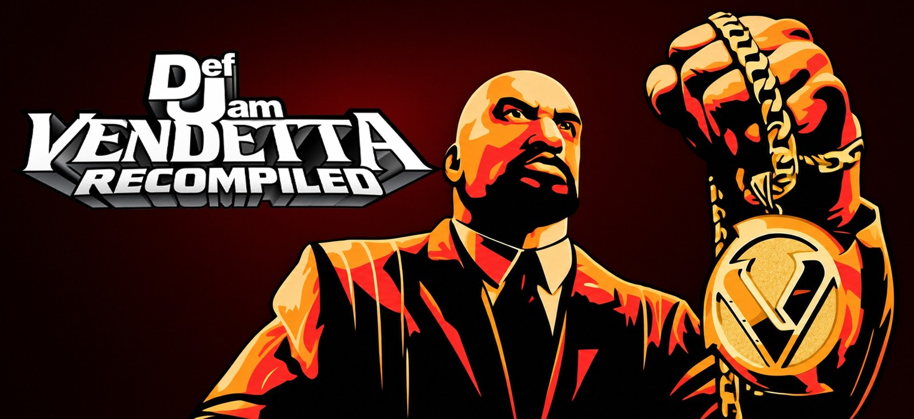

**Def Jam Vendetta, the PlayStation 2 fighter, as a native Windows program, built on your PC from your own disc.**

[](https://github.com/jcsix694/def-jam-vendetta-recomp/releases/latest)

[](https://github.com/jcsix694/def-jam-vendetta-recomp/releases/latest/download/Def-Jam-Vendetta-Recompiled-Windows.zip)

Made by [@jcsix on X](https://x.com/jcsix) · [jcsix694 on GitHub](https://github.com/jcsix694)

</div>

The original PlayStation 2 code is translated to C++ with [PS2Recomp](https://github.com/ran-j/PS2Recomp) and compiled on your
PC, so your CPU runs the game directly. No emulator. **No game files come with it:** you need your own copy of Def Jam
Vendetta (PlayStation 2, USA, **SLUS-20639**) as an `.iso` or `.chd`, and everything made from it stays on your PC.

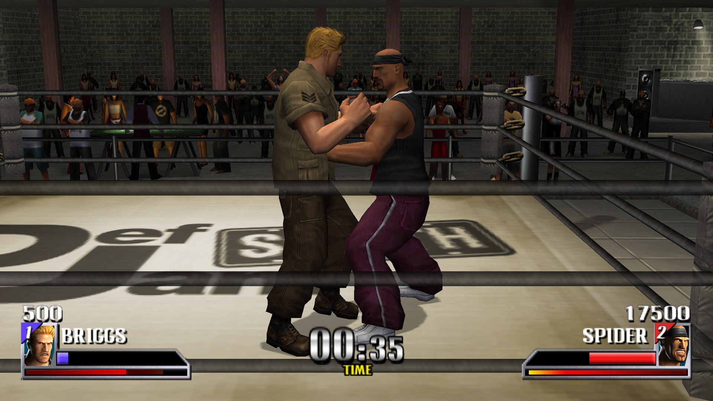

## PS2 vs PC

| | PS2 | PC |
| --- | --- | --- |
| **Resolution** | 640 × 448 | up to 16× (supersampled), scaled to your screen with AMD FSR |
| **Aspect ratio** | 4:3 | 16:9 in matches, 4:3 menus and movies |
| **HUD, text and menus** | native resolution | the same scale as the 3D (Sharp 2D, optional) |
| **Models in 3- and 4-fighter matches** | Low Poly | High Poly (optional) |
| **Players** | 4 with a multitap | 4 controllers, plus the keyboard |
| **Vibration** | DualShock 2 | Xbox-style controllers |
| **Display** | TV | window, borderless or fullscreen |
| **Saves** | memory card | memory card files on your PC |

## Screenshots

<table>
<tr>
<td width="33%">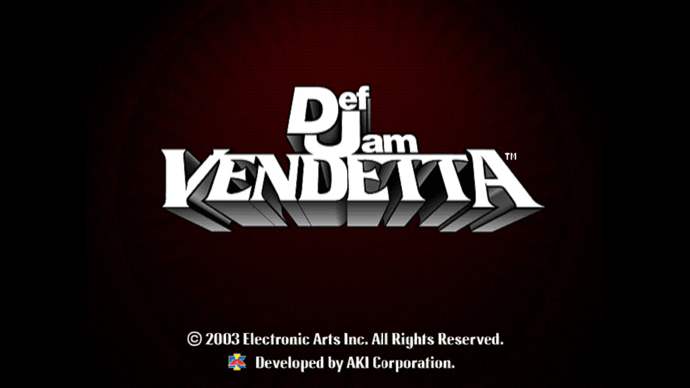</td>
<td width="33%">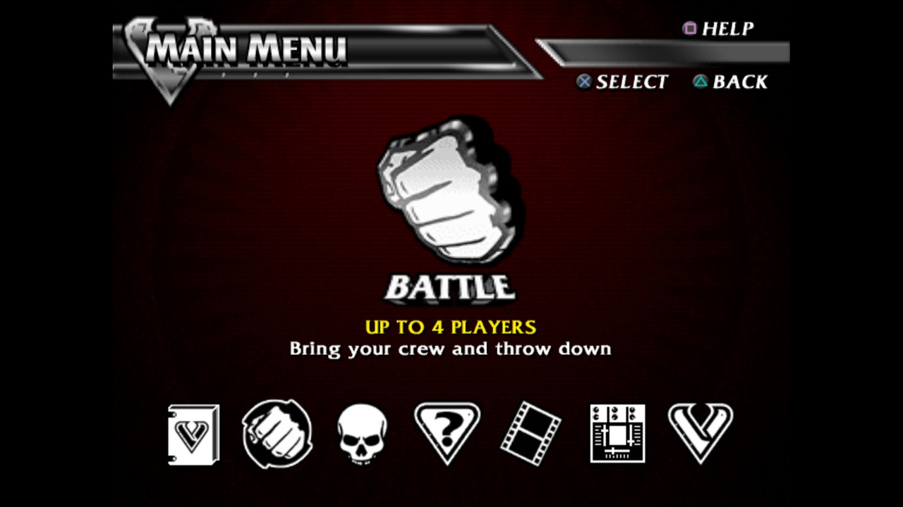</td>
<td width="33%">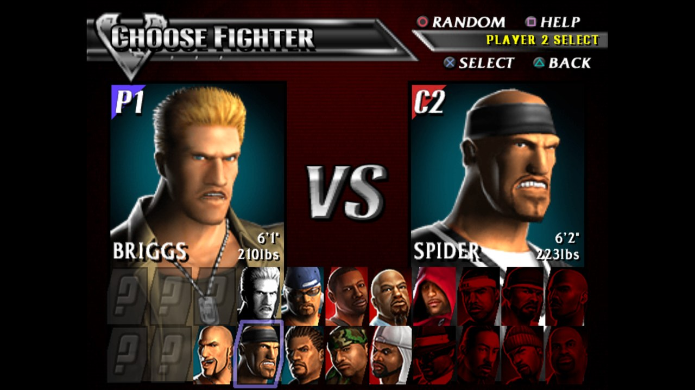</td>
</tr>
<tr>
<td>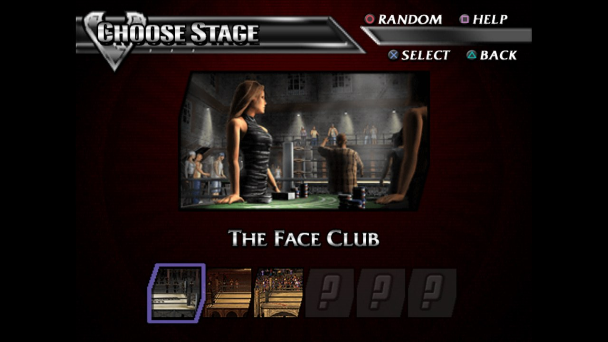</td>
<td>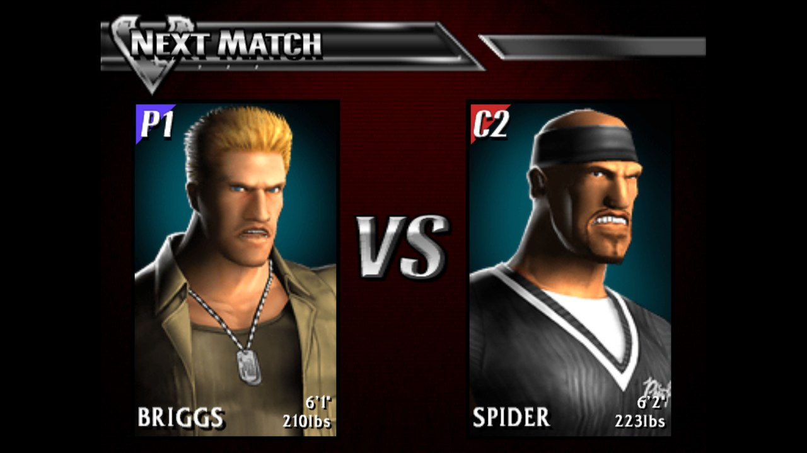</td>
<td>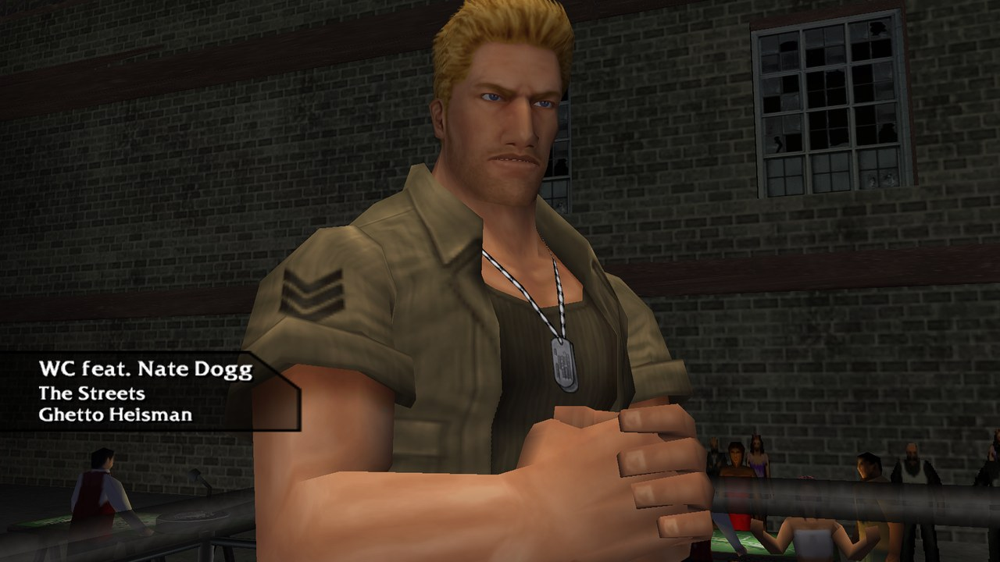</td>
</tr>
<tr>
<td>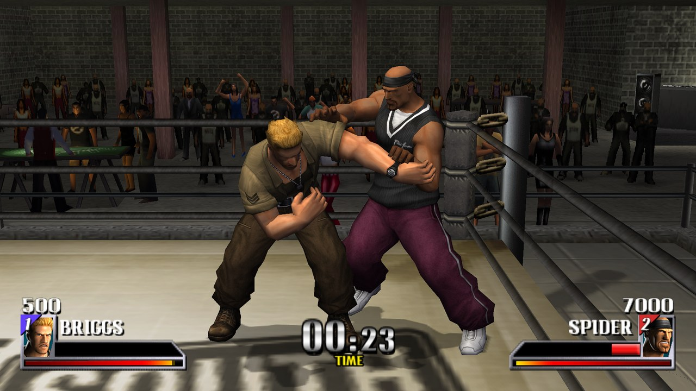</td>
<td>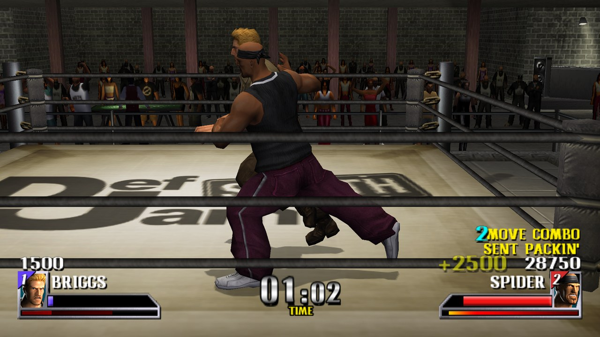</td>
<td>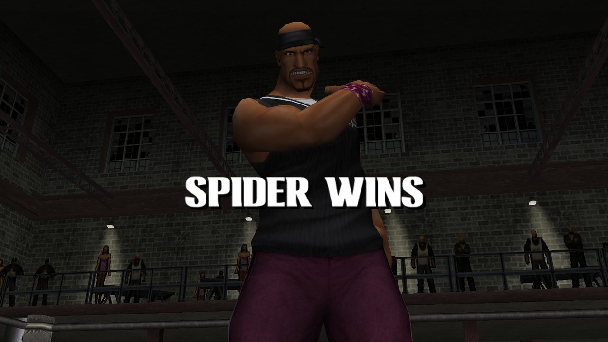</td>
</tr>
</table>

<sub>All taken on PC at the default settings: 16×, Sharp 2D, widescreen.</sub>

## Install

**You need:** Windows 10 or 11 (64-bit) · a graphics card with Vulkan 1.3 (any recent NVIDIA, AMD or Intel Arc card) ·
about 8 GB of free space · the internet once · your own Def Jam Vendetta disc (USA, SLUS-20639) as an `.iso` or `.chd`.

<table>
<tr>
<td width="50%" valign="top">

1. Download [**Def-Jam-Vendetta-Recompiled-Windows.zip**](https://github.com/jcsix694/def-jam-vendetta-recomp/releases/latest/download/Def-Jam-Vendetta-Recompiled-Windows.zip)
   (the latest version, also on the [releases page](https://github.com/jcsix694/def-jam-vendetta-recomp/releases/latest)).
2. Unzip it somewhere short, like your Desktop or `C:\Games`. The build tools can't handle very long folder paths.
3. Open **Def Jam Vendetta Recompiled Settings.exe**.
4. Pick your disc file, or drop it onto the window. It's checked to be the right disc.
5. Press **Next: build the game**. Microsoft's free C++ build tools are installed first if your PC doesn't have them
   (allow Windows' prompt once). The build takes **20 to 30 minutes, once**, and you can keep using your PC.
6. Choose your settings and press **PLAY**. Two shortcuts go on your desktop: **Def Jam Vendetta Recompiled** starts
   the game straight away, and **Def Jam Vendetta Recompiled Settings** opens the settings.

</td>
<td width="50%" valign="top">
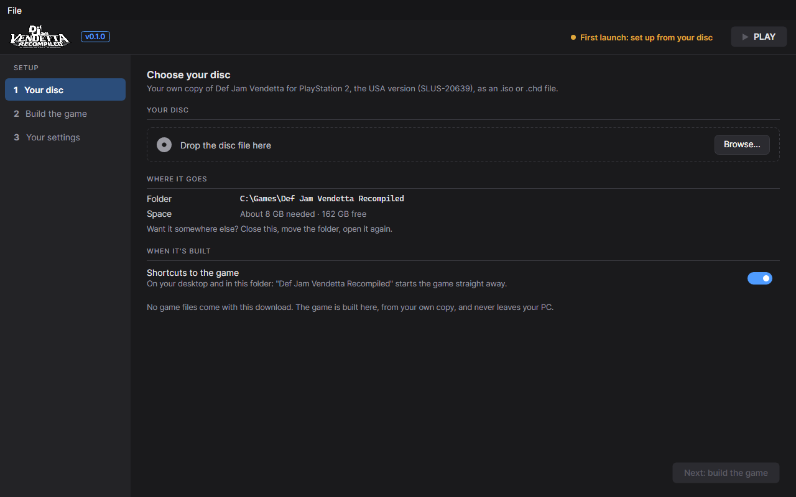
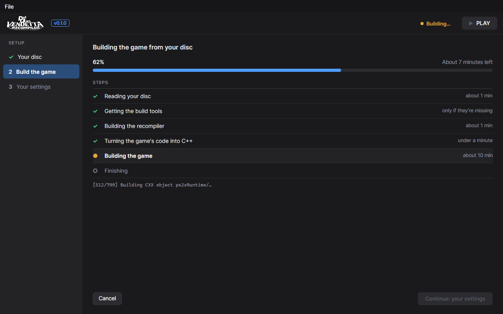
</td>
</tr>
</table>

> [!TIP]
> Windows may say *"Windows protected your PC"* because the program isn't code-signed yet. Click **More info**, then
> **Run anyway**.

**Updating:** Def Jam Vendetta Recompiled Settings checks for a new version when it opens and offers it on its Play page. An update is a
small download, then the game is rebuilt in a few minutes. Your settings and saves are kept.

## Def Jam Vendetta Recompiled Settings

<table>
<tr>
<td width="33%">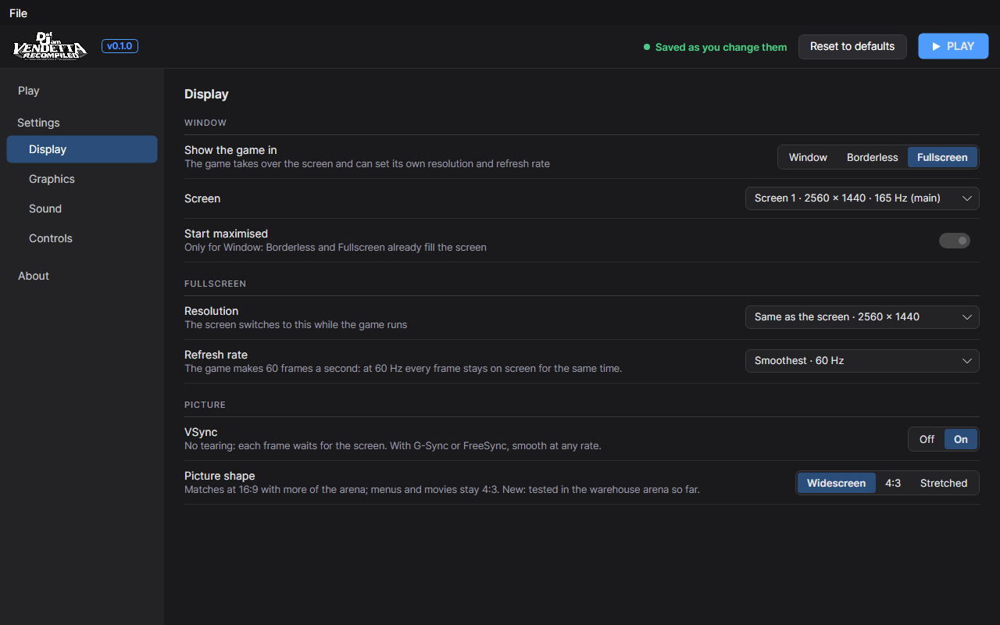</td>
<td width="33%">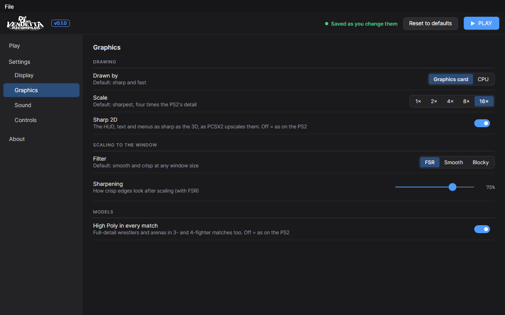</td>
<td width="33%">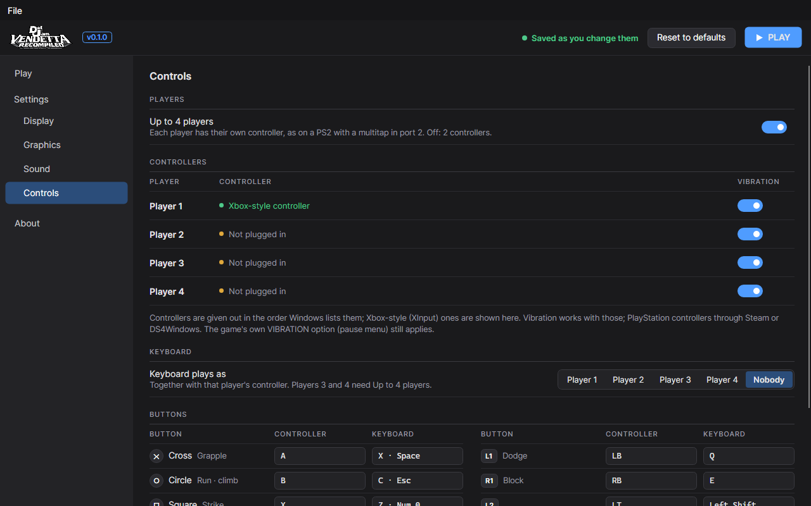</td>
</tr>
</table>

- **Display:** window, borderless or fullscreen, which screen, fullscreen resolution and refresh rate, VSync, and
  widescreen, 4:3 or stretched.
- **Graphics:** graphics card or CPU, scale 1× to 16×, Sharp 2D, FSR, smooth or blocky scaling with sharpening, and
  High Poly in every match.
- **Sound:** volume and the arena reverb.
- **Controls:** up to 4 players, each player's controller and vibration, which player the keyboard plays as, and what
  every button does.
- **About:** the version, your game folder and save data in one click, and what it's made with.

## Controls

| PS2 | In a match | Controller (Xbox layout) | Keyboard |
| --- | --- | --- | --- |
| D-pad / left stick | move | D-pad / left stick | Arrow keys / W A S D |
| ✕ Cross | grapple | A | X / Space |
| ○ Circle | run, climb | B | C / Esc |
| □ Square | strike | X | Z / Numpad 0 |
| △ Triangle | | Y | V / Numpad 1 |
| L1 / R1 | dodge / block | LB / RB | Q / E |
| L2 / R2 | | LT / RT | Left Shift / Right Shift |
| Right stick | taunt, Blazin' | right stick | I J K L |
| Start / Select | pause | Menu / View | Enter / Tab |

Xbox-style controllers work out of the box, with vibration, and are given to players in the order Windows lists them.
PlayStation controllers work through Steam or DS4Windows. The keyboard plays as nobody until you pick a player on the
Controls page.

## Good to know

- **Your saves** are memory card files in `files\game\mc0` (About › Open save data). Copy that folder to back them up.
- **Running slowly?** 16× (the default) needs a fairly strong graphics card: try 8× on the Graphics page.
- **The very first start** is slow for about a minute while the graphics card prepares its shaders.
- **Vibration** can also be turned off in the game's own pause menu.
- **Your settings** are in `files\settings.toml`. Def Jam Vendetta Recompiled Settings writes it, and you can edit it by hand.
- **Mods** are not supported yet, but are currently being worked on.

<details>
<summary><b>For developers: building from source</b></summary>

<br>

The build translates the game's code from your own disc, so you need one here too. This repository has no game files
or game code. Everything made from your disc (`disc\`, `game\`, `generated\`) stays on your PC and is ignored by git.

Needs Windows, [Visual Studio 2022 Build Tools](https://visualstudio.microsoft.com/downloads/) (the "Desktop
development with C++" workload), Python 3 and git. Def Jam Vendetta Recompiled Settings needs the .NET 10 SDK.

```bat
git clone https://github.com/jcsix694/def-jam-vendetta-recomp
cd def-jam-vendetta-recomp
setup.bat                                        :: the submodules, PS2Recomp + our patch, the recompiler
python tools\prepare_disc.py "D:\path\to\Def Jam Vendetta.chd"    :: or the .iso
recomp.bat                                       :: the game's code → C++ (~2 min)
build-fast.bat                                   :: build it (first time ~12 min)
run.bat                                          :: run it
build-settings.bat                               :: Def Jam Vendetta Recompiled Settings
make-release.bat                                 :: a player's zip in dist\ (nothing is published)
```

Clone without `--recurse-submodules`: `setup.bat` fetches only the parts of paraLLEl-GS's own submodules it needs (a
full recursive clone runs into Windows' path-length limit). `prepare_disc.py` checks it's the right disc, then writes
`disc\SLUS-20639.iso` (the game reads its disc by sector) and `game\` (the disc's files). A player's zip has Vendetta
Settings, a portable Python and the source with our patches applied. Its first launch runs `tools\setup_game.py`.

The game reads `settings.toml` from its folder. A switch set before `run.bat` wins over the file:

| Switch | |
|---|---|
| `VENDETTA_SSAA=1/2/4/8/16` | samples per pixel on the graphics card (`scale`) |
| `VENDETTA_GS=cpu` | draw on the CPU instead (the PS2's own resolution) |
| `VENDETTA_FILTER=fsr/bilinear/nearest` | scaling to the window (`filter`), and `VENDETTA_SHARPEN=0..2` for FSR's sharpening |
| `VENDETTA_GPU=<number or name>` | which graphics card, e.g. `nvidia` |
| `VENDETTA_WIDESCREEN=16:9/21:9/16:10/1` | the match's view widened (`shape`) |
| `VENDETTA_UPSCALE_SPRITES=1/0` · `VENDETTA_HIGHPOLY=1/0` | Sharp 2D (`sharp_2d`) · High Poly in every match (`high_poly`) |
| `VENDETTA_KEYBOARD=1..4/0` | the keyboard's player (`keyboard`, 0 = nobody) |
| `VENDETTA_SPU_INTERP=linear` | the sound chip's voices interpolated linearly instead of the PS2's Gaussian |

F1 shows the debug panel. In the repository: `config\` (the recompiler's inputs: the function map from Ghidra, Sony
library routines bound to the runtime's own, missed function starts), `overrides\` (game-specific runtime code),
`patches\` (our changes to PS2Recomp and paraLLEl-GS), `settings-app\` (Def Jam Vendetta Recompiled Settings, Avalonia on .NET 10),
`third_party\parallel-gs` (submodule), `tools\` (disc preparation, the VU1 recompiler, release and setup scripts,
debugging helpers).

</details>

## Thanks to

- **Def Jam Vendetta** by AKI Corporation, published by EA Sports BIG (2003).
- [**PS2Recomp**](https://github.com/ran-j/PS2Recomp) by ran-j, which translates the PS2 code and runs it.
- [**paraLLEl-GS**](https://github.com/Arntzen-Software/parallel-gs) by Arntzen Software, the PS2's graphics chip on
  your graphics card (with [Granite](https://github.com/Themaister/Granite)).
- [raylib](https://github.com/raysan5/raylib), [Dear ImGui](https://github.com/ocornut/imgui), [FFmpeg](https://ffmpeg.org),
  [Avalonia](https://github.com/AvaloniaUI/Avalonia) and the rest in `THIRD-PARTY-NOTICES.txt`.

## Licence

Copyright (C) 2026 jcsix694 (@jcsix on X). Free software under the **GNU General Public License version 3** (`LICENSE`):
use it, change it and share it. A changed version you share must come with its source, under the same licence.

It has to be the GPL: PS2Recomp (ran-j, GPL-3.0) is built into the game program, and our changes to it (`patches\`) are
under its licence. Our changes to paraLLEl-GS (`patches\parallel-gs-local.diff`) are under its LGPL-3.0+. paraLLEl-GS
(© Arntzen Software AS) is LGPL-3.0+ and uses Granite (© Hans-Kristian Arntzen, MIT). Both are included as submodules.
Every other part and its licence: `THIRD-PARTY-NOTICES.txt`.

<sub>Not affiliated with or endorsed by Electronic Arts, EA Sports BIG, AKI Corporation or Def Jam Recordings. Def Jam
Vendetta and its name, logo and artwork belong to their owners. The banner and Def Jam Vendetta Recompiled Settings' pictures are artwork
based on its logo, and the licence doesn't cover them. This repository contains no game code or game files. The
screenshots are of the game running on PC. Please don't open issues asking for game files.</sub>
